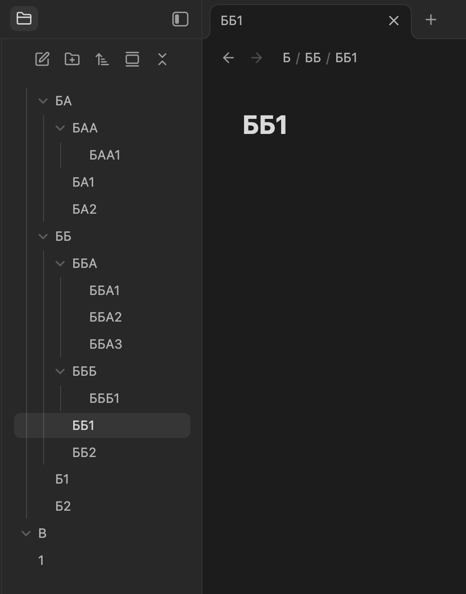
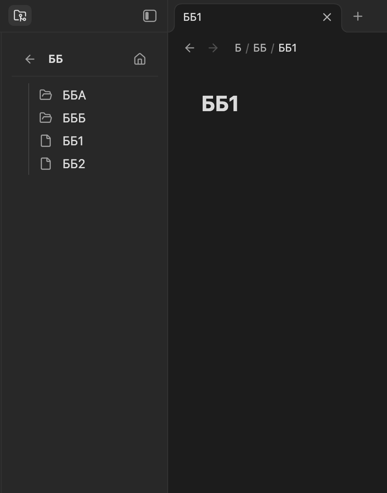
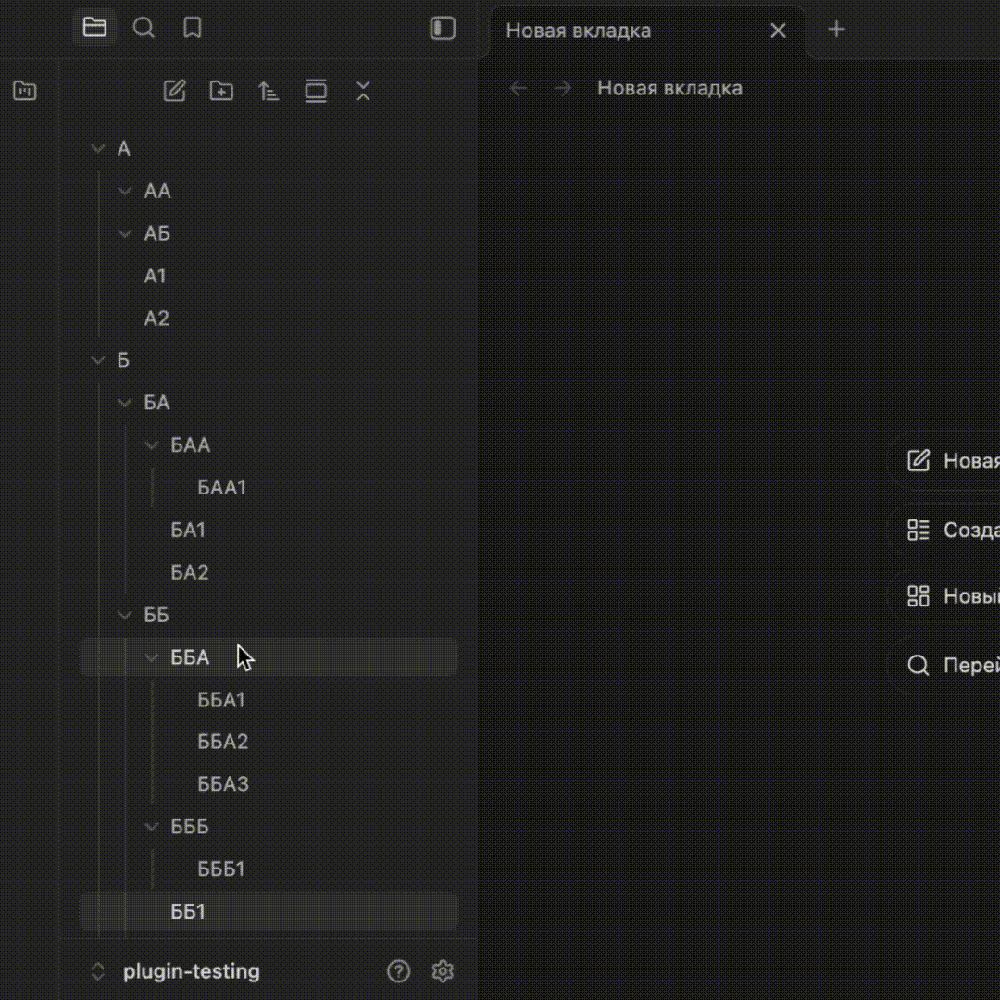

# Adaptive Explorer for Obsidian

Adaptive Explorer is an alternative file navigation plugin for Obsidian that completely reimagines how you browse your vault. Instead of a cluttered, endless vertical folder tree, it offers a clean, isolated view that automatically adapts to your active note.

| Before | After |
| :---: | :---: |
|  |  |

## 🌟 Features

*   **Auto Drill-Down:** The plugin instantly detects the location of your active note and automatically opens its specific folder, hiding all other irrelevant directories.
*   **Context Isolation:** View only the files and subfolders inside the current directory. No more visual noise from hundreds of unrelated folders in your sidebar.
*   **Breadcrumb & History Navigation:** Easily move up a level with the "Back" arrow or jump straight to the vault root with the "Home" button.
*   **Minimalist Interface:** Perfect for small screens, mobile devices, or anyone who prefers a clean, hyper-focused workspace.

## 🎬 Media & Guides

## 🚀 How it Works

1. Open any note in your editor.
2. The `Adaptive Explorer` sidebar view will automatically update to display the contents of the folder containing that note.
3. Click the "Back" arrow at the top of the pane to step up one level in your vault's directory structure.

## ⚙️ Installation

### Via Obsidian Community Plugins (Recommended)
1. Open Obsidian Settings and navigate to **Community plugins**.
2. Click **Browse** and search for `Adaptive Explorer`.
3. Click **Install**, then click **Enable**.

### Manual Installation
1. Download the latest release files (`main.js`, `manifest.json`, and `styles.css`) from the Releases page.
2. Inside your vault, navigate to `.obsidian/plugins/` and create a new folder named `adaptive-explorer`.
3. Move the downloaded files into that folder.
4. Restart Obsidian and enable the plugin in the **Community plugins** settings tab.

## 📄 License

This project is licensed under the MIT License.